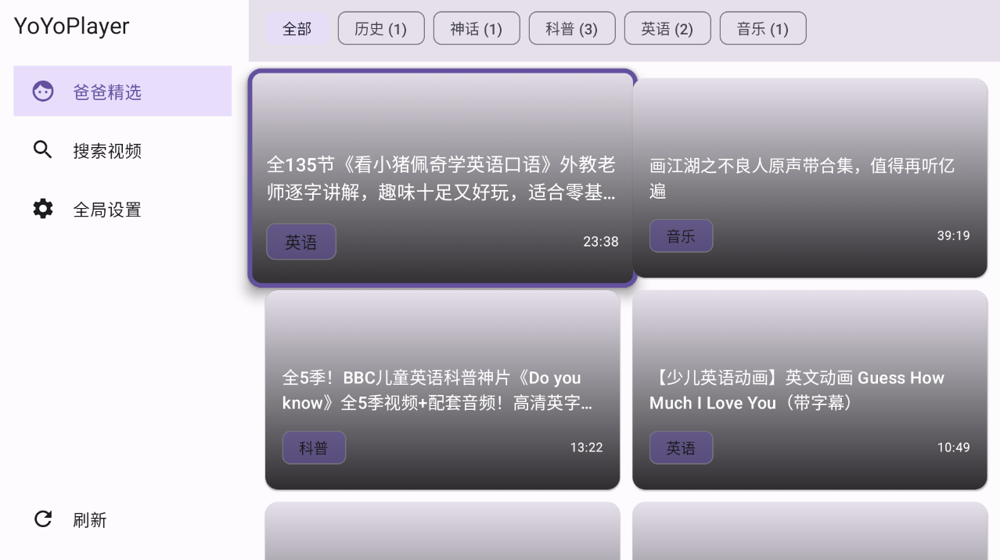

# YoYoPlayer

<p align="center">

<p>

Android TV 儿童视频播放器：只播放家长筛选过的 B 站视频内容，为孩子提供安全、纯净的观看环境。

## 特性

- 远程视频清单驱动，清单地址可在设置中配置
- 标签筛选、字幕选择与字幕样式、倍速播放
- 大屏 + 遥控器友好（LEANBACK 启动器）

## 环境要求

Android 5.0（API 21）+ · Android TV 设备 · 网络连接

## 构建

```bash
./gradlew assembleDebug     # 调试包
./gradlew assembleRelease   # 发布包
```

技术栈：Kotlin + Jetpack Compose + Retrofit/OkHttp。

## License

MIT
